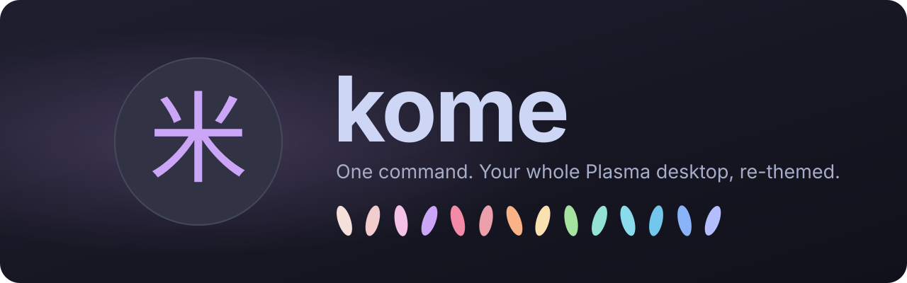
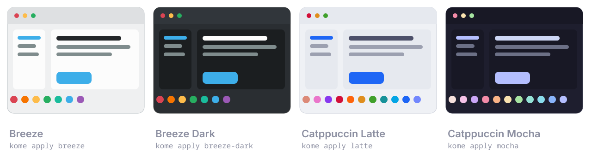
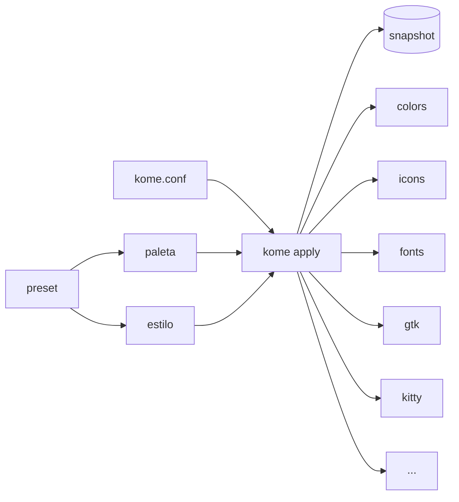

<div align="center">



<br>

[](https://github.com/MeltedGlitch/kome/actions/workflows/ci.yml)
[](LICENSE)
[](https://kde.org/plasma-desktop/)
[](#como-funciona)
[](#hoja-de-ruta)

**[Empezar](#empezar)** ·
**[Presets](#presets)** ·
**[Comandos](#comandos)** ·
**[Cómo funciona](#como-funciona)** ·
**[Preguntas](#preguntas-frecuentes)** ·
**[Contribuir](#contribuir)**

*[Read in English](README.md)*

</div>

---

**kome** (米, *arroz crudo* en japonés — un guiño a *ricing*) cambia **todo el
aspecto de KDE Plasma 6 con un solo comando**: colores, fuentes, iconos,
cursor, decoración de ventanas, apps GTK y tu terminal (kitty, Ghostty) — todo desde una misma
paleta, todo en armonía, y siempre a un comando de volver a como estaba.

```sh
kome apply mocha          # Catppuccin Mocha, en todas partes
kome restore original     # exactamente tu escritorio de antes de kome
```

> [!WARNING]
> **kome está en construcción.** El motor se está construyendo pieza a pieza
> (mira la [hoja de ruta](#hoja-de-ruta)); los comandos de esta página son el
> plan de la v0.1 y aún no se pueden usar. Dale una estrella o sigue el repo
> para no perderte nada.

## ✨ Por qué kome

- 🎨 **Una paleta, todo el escritorio.** Plasma, las apps GTK, los iconos y la
  terminal se generan con los mismos colores, así que nada desentona.
- ↩️ **Siempre reversible.** kome guarda una foto de tu escritorio antes de
  tocarlo. `kome restore original` te devuelve tu aspecto exacto de antes;
  `kome purge` borra cualquier rastro de kome.
- 🤝 **Un buen invitado en tu sistema.** Sin root, sin instalar paquetes, sin
  demonios. kome solo escribe sus propios archivos y nunca pisa tu
  configuración ni otros programas. Tus wallpapers siguen siendo tuyos.
- 🧭 **Sin manual.** Cada aviso te dice el comando exacto que toca. ¿Te falta
  una fuente? `kome deps` te da el comando de instalación para *tu* gestor de
  paquetes.
- 🔤 **Texto nítido.** Un renderizado de fuentes opcional al estilo macOS
  (antialiasing en gris, hinting ligero, stem darkening) con Inter y
  JetBrains Mono.
- 🐧 **Pequeño y muy UNIX.** Shell POSIX y archivos INI, subcomandos al estilo
  git, man pages, autocompletado, `--dry-run`, códigos de salida con sentido.

<a id="empezar"></a>

## 🚀 Empezar

```sh
git clone https://github.com/MeltedGlitch/kome
cd kome
make install              # en ~/.local — sin root
```

Comprueba que tu shell lo encuentra:

```sh
command -v kome || echo "~/.local/bin no está en tu PATH"
```

<details>
<summary>¿No lo encuentra? Añade <code>~/.local/bin</code> a tu <code>PATH</code></summary>

Muchas distribuciones (Fedora, Ubuntu…) ya lo hacen por ti. Si la tuya no,
ejecuta la línea de tu shell y abre una terminal nueva:

```sh
# bash
echo 'export PATH="$HOME/.local/bin:$PATH"' >> ~/.bashrc

# zsh
echo 'export PATH="$HOME/.local/bin:$PATH"' >> ~/.zshrc

# fish
fish_add_path ~/.local/bin
```

</details>

El autocompletado con Tab funciona en bash y fish al abrir una terminal
nueva. En zsh, añade `fpath=(~/.local/share/zsh/site-functions $fpath)` a
`~/.zshrc` antes de `compinit`.

Y luego:

```sh
kome doctor               # qué se puede tematizar aquí y qué falta
kome apply mocha          # elige un look
```

<details>
<summary>Instalación para todo el sistema, empaquetado, desinstalar</summary>

```sh
sudo make install PREFIX=/usr/local     # para todo el sistema
make install DESTDIR=/tmp/stage         # staging, para empaquetadores
kome purge && make uninstall            # quita kome y todo lo que creó
```

</details>

<a id="presets"></a>

## 🍙 Presets



La v0.1 trae cuatro looks — un preset, un modo. Para la v0.2 están previstos
Tokyo Night, Rosé Pine, Rosé Pine Dawn, Nord, Everforest, Gruvbox Material y
Kanagawa. Cada paleta se construye desde los colores oficiales de su proyecto.

Paletas y estilos son archivos separados, así que puedes mezclarlos: los
colores de un look con las fuentes y formas de otro.

<a id="comandos"></a>

## 🧰 Comandos

| Comando | Qué hace |
|---|---|
| `kome apply <preset>` | Aplica un look. `-n` enseña el plan sin cambiar nada |
| `kome list` | Lista los presets disponibles |
| `kome status` | Muestra el preset activo y lo que hayas cambiado a mano desde entonces |
| `kome doctor` | Comprueba qué se puede tematizar y por qué no; `--fix` lo arregla, `--info` da datos del sistema |
| `kome deps <preset>` | Da el comando para instalar lo que le falte al preset |
| `kome restore original` | Vuelve a tu escritorio de antes de kome |
| `kome restore previous` | Deshace el último apply |
| `kome purge` | Restaura `original` y borra todo lo que kome creó |

<a id="como-funciona"></a>

## ⚙️ Cómo funciona



Todo lo que cambia tu escritorio es una **unit**: un programa pequeño e
independiente en `units/` con exactamente tres verbos — `check`, `apply` y
`current`. Las units leen sus valores de variables de entorno `KOME_*`,
rellenan sus propias plantillas y usan las herramientas que ya trae Plasma
(`plasma-apply-colorscheme`, `kwriteconfig6`, D-Bus). Dar soporte a algo
nuevo es añadir una carpeta; el núcleo no cambia.

<a id="hoja-de-ruta"></a>

## 🗺️ Hoja de ruta

**v0.1**

- [x] Dispatcher, funciones comunes, CI
- [x] Lector de INI
- [x] Motor de color (mezclar, aclarar, oscurecer, contraste WCAG)
- [x] Motor de plantillas
- [x] Units `colors`, `icons`, `fonts`, `cursor`, `rendering`, `kitty`, `ghostty`
- [ ] Unit: `wallpaper`
- [x] Comandos: `apply`, `list`, `restore`, `deps`, `status`, `doctor`, `purge`
- [x] Presets: Breeze, Breeze Dark, Catppuccin Latte, Catppuccin Mocha
- [x] Autocompletado (bash, zsh, fish)
- [ ] Man pages

**v0.2** — más presets; decoración de ventanas (Klassy), estilo de widgets y
layouts del panel; un pequeño selector gráfico.

<a id="preguntas-frecuentes"></a>

## ❓ Preguntas frecuentes

<details>
<summary><b>¿Necesito root?</b></summary>

No. kome se instala en `~/.local` y solo cambia ajustes de usuario. Nunca
ejecuta `sudo` y nunca instala paquetes.
</details>

<details>
<summary><b>¿Me va a liar la configuración?</b></summary>

kome solo escribe archivos suyos. Cuando un archivo tuyo tiene que apuntar a
ellos (por ejemplo, una línea `include` en `kitty.conf`), kome te avisa y solo
añade esa única línea cuando ejecutas `kome doctor --fix`. Cualquier cosa que
toque otro programa te pregunta antes, `[y/N]`.
</details>

<details>
<summary><b>¿Cómo vuelvo atrás?</b></summary>

`kome restore original` te devuelve el escritorio exactamente como estaba
antes de que kome se ejecutara por primera vez, fuera el tema que fuera.
`kome restore previous` deshace solo el último cambio. `kome purge` restaura
`original` y borra todos los archivos que kome creó.
</details>

<details>
<summary><b>Un preset necesita una fuente o un tema de iconos que no tengo.</b></summary>

kome te enseña lo que falta antes de cambiar nada. `kome deps <preset>` te da
el comando exacto para tu gestor de paquetes (dnf, apt, pacman, zypper…).
También puedes aplicar todo lo posible con `--partial`.
</details>

<details>
<summary><b>Algunos iconos del panel no han cambiado.</b></summary>

Es un fallo conocido de Plasma: tras cambiar de tema de iconos, Plasma solo
repinta algunos iconos del panel cuando pasas el ratón por encima — también
si los cambias desde Ajustes del sistema. Por eso, cada vez que kome cambia
tus iconos, refresca el panel por ti (parpadea un segundo). ¿No lo quieres?
Pon `RefreshPanel=off` en `[General]` de `~/.config/kome/kome.conf` y kome
solo te dirá cómo hacerlo tú.
</details>

<details>
<summary><b>¿Me cambia el wallpaper?</b></summary>

No. Tus wallpapers se quedan. El soporte de wallpaper existe, pero hay que
activarlo.
</details>

<details>
<summary><b>¿Por qué no un Tema Global de KDE y ya?</b></summary>

Los Temas Globales son estáticos — no pueden generar colores a partir de una
paleta — y aplicar uno resetea el panel y otros ajustes de golpe. kome
trabaja familia de ajustes a familia de ajustes, y siempre puede deshacerlo.
</details>

<a id="contribuir"></a>

## 🤝 Contribuir

kome está hecho para la comunidad, por la comunidad. Ideas, issues y pull
requests son bienvenidos.

- **Un look nuevo** es una paleta (`share/kome/palettes/*.ini`) más un
  preset — INI, sin código.
- **Soporte para una app nueva** es una carpeta de unit en `units/`.
- Ejecuta `make check` (ShellCheck + bats) antes de mandar un cambio.

El diseño completo y su porqué están en [CLAUDE.md](CLAUDE.md).

## 💜 Agradecimientos

kome se apoya en
[Catppuccin](https://catppuccin.com),
[Papirus](https://github.com/PapirusDevelopmentTeam/papirus-icon-theme),
[KDE](https://kde.org) y en cada autor de temas que comparte sus paletas con
el mundo.

## 📜 Licencia

[GPL-3.0-or-later](LICENSE). Hecho sobre temas de la comunidad, devuelto a la
comunidad.
