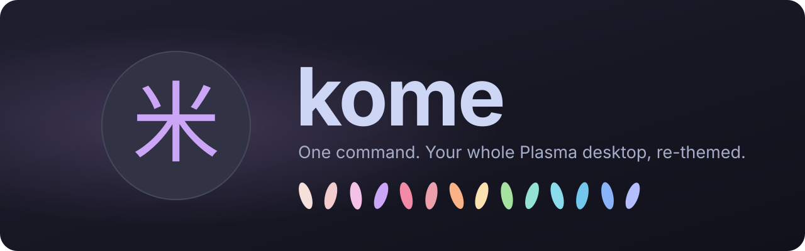
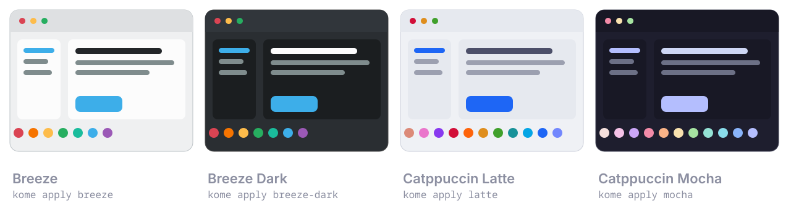
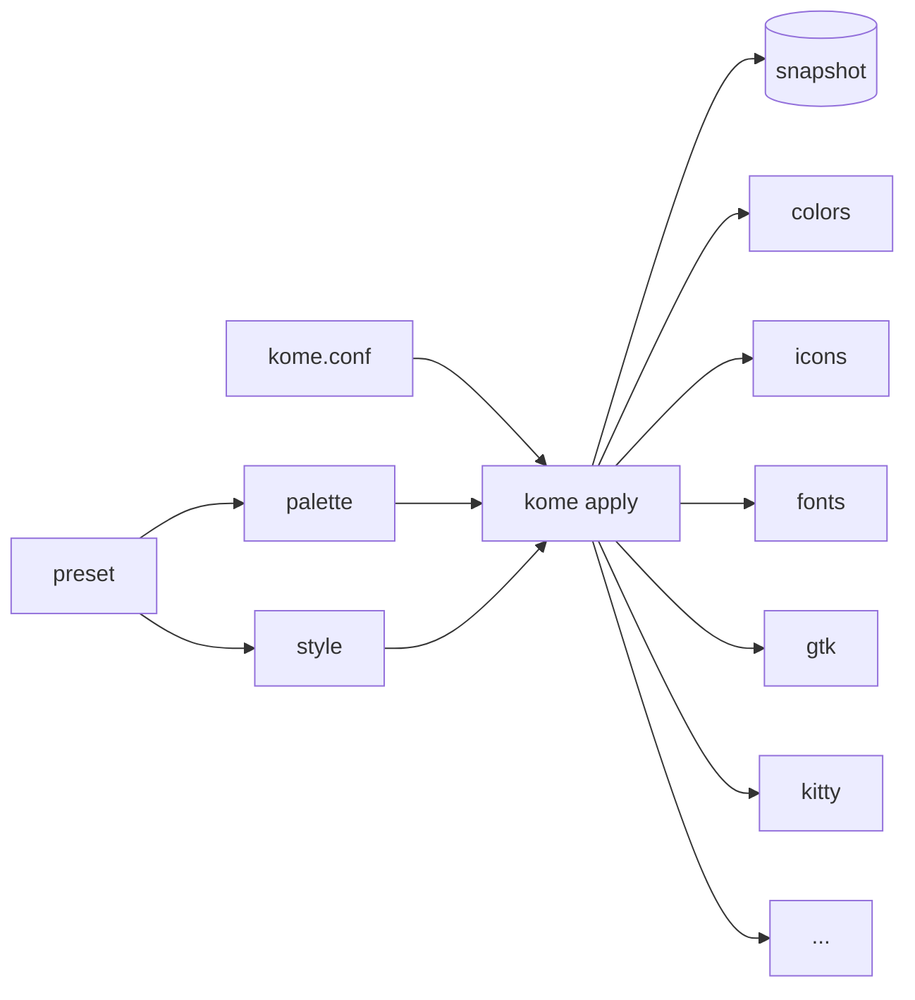

<div align="center">



<br>

[](https://github.com/MeltedGlitch/kome/actions/workflows/ci.yml)
[](LICENSE)
[](https://kde.org/plasma-desktop/)
[](#how-it-works)
[](#roadmap)

**[Quick start](#quick-start)** ·
**[Presets](#presets)** ·
**[Commands](#commands)** ·
**[How it works](#how-it-works)** ·
**[FAQ](#faq)** ·
**[Contributing](#contributing)**

*[Leer en español](README.es.md)*

</div>

---

**kome** (米, *uncooked rice* in Japanese — a nod to *ricing*) changes the
**whole look of KDE Plasma 6 in one command**: colours, fonts, icons, cursor,
window decorations, GTK apps and your terminal — all from one palette, all in
harmony, and always one command away from how it was before.

```sh
kome apply mocha          # Catppuccin Mocha, everywhere
kome restore original     # exactly your desktop from before kome
```

> [!WARNING]
> **kome is under construction.** The engine is being built piece by piece
> (see the [roadmap](#roadmap)); the commands on this page are the v0.1 plan
> and are not usable yet. Star or watch the repo to follow along.

## ✨ Why kome

- 🎨 **One palette, the whole desktop.** Plasma, GTK apps, icons and the
  terminal are all generated from the same colours, so nothing clashes.
- ↩️ **Always reversible.** kome snapshots your desktop before touching it.
  `kome restore original` brings back your exact previous look; `kome purge`
  removes every trace of kome.
- 🤝 **A good guest on your system.** No root, no package installs, no
  daemons. kome writes only its own files and never overrides your config or
  other programs. Your wallpapers stay yours.
- 🧭 **No manual needed.** Every warning tells you the exact next command to
  run. Missing a font? `kome deps` prints the install command for *your*
  package manager.
- 🔤 **Crisp text.** An optional, macOS-like font rendering setup (greyscale
  antialiasing, slight hinting, stem darkening) with Inter and JetBrains Mono.
- 🐧 **Small and UNIX-y.** Plain POSIX shell and INI files, git-style
  subcommands, man pages, shell completions, `--dry-run`, sane exit codes.

<a id="quick-start"></a>

## 🚀 Quick start

```sh
git clone https://github.com/MeltedGlitch/kome
cd kome
make install              # into ~/.local — no root needed
```

Check that your shell can find it:

```sh
command -v kome || echo "~/.local/bin is not in your PATH"
```

<details>
<summary>Not found? Add <code>~/.local/bin</code> to your <code>PATH</code></summary>

Many distributions (Fedora, Ubuntu…) already do this for you. If yours does
not, run the line for your shell, then open a new terminal:

```sh
# bash
echo 'export PATH="$HOME/.local/bin:$PATH"' >> ~/.bashrc

# zsh
echo 'export PATH="$HOME/.local/bin:$PATH"' >> ~/.zshrc

# fish
fish_add_path ~/.local/bin
```

</details>

Then:

```sh
kome doctor               # what can be themed here, and what is missing
kome apply mocha          # pick a look
```

<details>
<summary>System-wide install, packaging, uninstall</summary>

```sh
sudo make install PREFIX=/usr/local     # system-wide
make install DESTDIR=/tmp/stage         # staging, for packagers
kome purge && make uninstall            # remove kome and everything it created
```

</details>

<a id="presets"></a>

## 🍙 Presets



v0.1 ships four looks — one preset, one mode. More are planned for v0.2:
Tokyo Night, Rosé Pine, Rosé Pine Dawn, Nord, Everforest, Gruvbox Material
and Kanagawa. Every palette is authored from its official upstream colours.

Palettes and styles are separate files, so you can mix them: the colours of
one look with the fonts and shapes of another.

<a id="commands"></a>

## 🧰 Commands

| Command | What it does |
|---|---|
| `kome apply <preset>` | Apply a look. `-n` shows the plan without changing anything |
| `kome list` | List available presets |
| `kome status` | Show the active preset and anything changed by hand since |
| `kome doctor` | Check what can be themed and why not; `--fix` repairs, `--info` shows system facts |
| `kome deps <preset>` | Print the install command for whatever the preset is missing |
| `kome restore original` | Go back to your desktop from before kome |
| `kome restore previous` | Undo the last apply |
| `kome purge` | Restore `original` and delete everything kome created |

<a id="how-it-works"></a>

## ⚙️ How it works



Everything that changes your desktop is a **unit**: a small, independent
program in `units/` with exactly three verbs — `check`, `apply` and
`current`. Units read their values from `KOME_*` environment variables, fill
their own templates, and use the tools Plasma already ships
(`plasma-apply-colorscheme`, `kwriteconfig6`, D-Bus). Adding support for
something new means adding one directory; the core does not change.

<a id="roadmap"></a>

## 🗺️ Roadmap

**v0.1**

- [x] Dispatcher, shared helpers, CI
- [x] INI reader
- [x] Colour engine (mix, lighten, darken, WCAG contrast)
- [x] Template engine
- [x] Units `colors`, `icons`, `fonts`, `cursor`
- [ ] Units: `gtk`, `kitty`, `rendering`, `wallpaper`
- [x] Commands: `apply`, `list`, `restore`, `deps`, `status`, `doctor`, `purge`
- [x] Presets: Breeze, Breeze Dark, Catppuccin Latte, Catppuccin Mocha
- [ ] Man pages and shell completions

**v0.2** — more presets; window decorations (Klassy), widget style and panel
layouts; a small graphical picker.

<a id="faq"></a>

## ❓ FAQ

<details>
<summary><b>Do I need root?</b></summary>

No. kome installs into `~/.local` and only changes user-level settings. It
never runs `sudo` and never installs packages.
</details>

<details>
<summary><b>Will it mess up my configuration?</b></summary>

kome only writes files it owns. When one of your files needs to point to
them (for example an `include` line in `kitty.conf`), kome tells you and adds
that single line only when you run `kome doctor --fix`. Anything that would
touch another program asks first, `[y/N]`.
</details>

<details>
<summary><b>How do I go back?</b></summary>

`kome restore original` brings back your desktop exactly as it was before
kome ever ran, whatever theme that was. `kome restore previous` undoes only
the last change. `kome purge` restores `original` and deletes every file
kome created.
</details>

<details>
<summary><b>A preset needs a font or icon theme I don't have.</b></summary>

kome lists what is missing before changing anything. `kome deps <preset>`
prints the exact command for your package manager (dnf, apt, pacman,
zypper…). You can also apply as much as possible with `--partial`.
</details>

<details>
<summary><b>Some panel icons did not change.</b></summary>

That is Plasma, not kome: after switching icon themes, Plasma repaints some
panel and desktop icons only when you hover them — even when you change
icons in System Settings. Hover them, or restart the panel with
`systemctl --user restart plasma-plasmashell`.
</details>

<details>
<summary><b>Does it change my wallpaper?</b></summary>

No. Your wallpapers are kept. Wallpaper support exists but is opt-in.
</details>

<details>
<summary><b>Why not just a KDE Global Theme?</b></summary>

Global Themes are static — they cannot generate colours from a palette — and
applying one resets your panel layout and other settings wholesale. kome
works one setting family at a time, and can always undo it.
</details>

<a id="contributing"></a>

## 🤝 Contributing

kome is built for the community, by the community. Ideas, issues and pull
requests are welcome.

- **A new look** is a palette (`share/kome/palettes/*.ini`) plus a preset —
  plain INI, no code.
- **Support for a new app** is one unit directory in `units/`.
- Run `make check` (ShellCheck + bats) before sending a change.

The full design and its reasoning live in [CLAUDE.md](CLAUDE.md).

## 💜 Acknowledgements

kome stands on the shoulders of
[Catppuccin](https://catppuccin.com),
[Papirus](https://github.com/PapirusDevelopmentTeam/papirus-icon-theme),
[KDE](https://kde.org) and every theme author who shares their palettes
with the world.

## 📜 Licence

[GPL-3.0-or-later](LICENSE). Built on community themes, given back to the
community.
